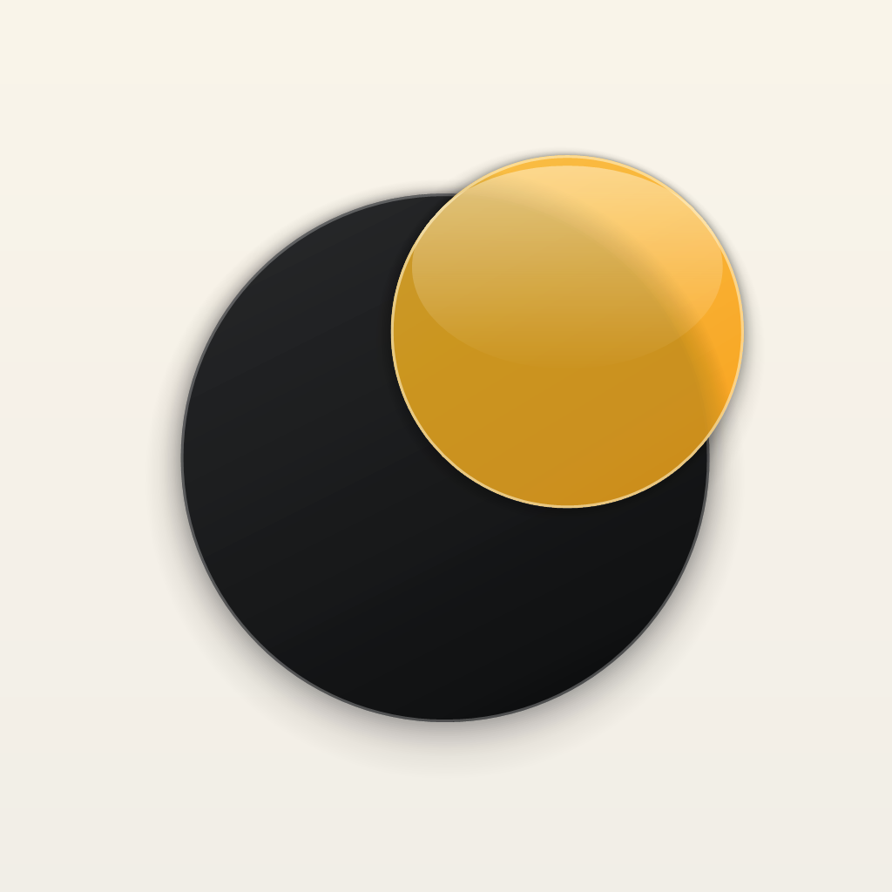

<p align="center">
  
</p>

<h1 align="center">PunPlayer</h1>

<p align="center">
  <b>A fast, private, artwork-first local music player for iPhone.</b><br>
  Built with Swift &amp; SwiftUI &middot; Zero tracking &middot; Pure local audio &middot; GNU GPLv3 &middot; <b>0.1 Beta</b>
</p>

<p align="center">
  <a href="https://github.com/Quancore21/PunPlayer/actions/workflows/build-ipa.yml"></a>
  <a href="https://github.com/Quancore21/PunPlayer/releases"></a>
  <a href="LICENSE"></a>
  
</p>

---

## Why PunPlayer?

In an era of monthly streaming subscriptions, algorithmic feeds, and cloud-locked libraries, **PunPlayer** is built for those who treasure owning their music collection.

No accounts. No sign-ups. No telemetry. No internet connection needed. Ever.

Drop your albums into the Files app, import via AirDrop, or pick documents from your device. PunPlayer turns your library into a warm, tactile, artwork-centered listening experience with signature amber aesthetics and liquid-smooth animations.

---

## Features & Highlights (0.1 Beta)

### Liquid Glass & Classic App Icons
Crafted from the Apple Icon Composer specification with translucent amber glass, an inner-specular dark planet, and a warm cream gradient. Switch freely between **Liquid Glass** (default) and **Classic** anytime in **Settings -> Personalization -> App icon**.

### PunPun Interactive Mascot Companion
Meet **PunPun** -- an optional interactive mascot who lives right inside the player and mini-player (enable in **Settings -> PunPun**):
- **Rhythm-Aware Dance:** Driven by `WaveformRhythmAnalyzer`, PunPun reads local RMS energy and onset flux from the decoded audio signal to sway calmly during quiet passages and groove during upbeat choruses.
- **Sleep & Tap Reactions:** Curls up to nap when playback is paused, and shows his happy love pose with floating hearts and soft haptics when tapped.
- **Animated Mini-Faces:** Expressive mini-badges in the mini-player and Settings that blink, wink, and smile.

### Signature 3D Orbit Transport
The Play/Pause button is a tribute to celestial mechanics and the PunPlayer mark. When tapped, an amber satellite swings into orbit around a central dark planet, passes behind it in 3D perspective, emerges along the diagonal axis, and settles into the new transport state. Playback starts or pauses **instantaneously** on touch.

### Real Decoded Waveforms with Background Preloading
No fake randomized sine waves. PunPlayer decodes the genuine PCM audio signal using `AVAudioFile` into precise amplitude buckets, preloaded in the background and cached atomically by file fingerprint for instant seek navigation.

### Gesture-Driven Navigation & Dynamic Island Clearance
- **Swipe left from right screen edge:** The current album tracklist slides in as a sleek trailing drawer positioned cleanly below the Dynamic Island and status bar.
- **Swipe up from bottom edge or anywhere on the screen:** The Track Actions sheet pops up effortlessly without fighting the iOS Home Indicator.

### Synced LRC Lyrics & Complete Library Management
- **Karaoke-style synced `.lrc` lyrics** with auto-scrolling.
- **Full library sorting:** Tracks, Albums, Artists, Genres, Folders, Smart Playlists, and Personal Playlists with `.m3u` export.
- **System integration:** Background audio playback, Lock Screen media controls, Control Center, and headphone remote handling.

---

## Audio Format Support

| Format | Container / Extension | Quality |
|---|---|---|
| **FLAC** | `.flac` | Lossless / Hi-Res (up to 24-bit / 192 kHz) |
| **Apple Lossless** | `.m4a`, `.alac` | Lossless |
| **WAV / AIFF** | `.wav`, `.aiff`, `.aif` | Uncompressed PCM |
| **AAC** | `.m4a`, `.aac` | High-efficiency compressed |
| **MP3** | `.mp3` | Standard compressed (ID3v1 / ID3v2.4) |

---

## Architecture & Under the Hood

```
PunPlayer/
+-- Core/             # Platform-independent models, pure logic, and algorithmic engine
|   +-- PlayQueue.swift          # Resilient queue, shuffle states & history tracking
|   +-- PlaybackSupport.swift    # Pure state resolvers (SeekRequestGate, EdgeSwipeResolver)
|   +-- Lyrics.swift             # Timestamped LRC lyrics parser & synchronizer
|   +-- Song.swift               # Stable multi-artist album ordering & folder trees
|   \-- M3UWriter.swift          # Standard playlist serialization
+-- Playback/         # AVPlayer wrapper, audio sessions & lock screen metadata
|   +-- PlayerEngine.swift       # Audio engine, session interruptions, remote commands
|   \-- PlaybackErrorMapper.swift # AVFoundation / CoreAudio error classification
+-- Services/         # Background storage, file import, waveform decoding
|   +-- WaveformCache.swift      # Background actor for multi-channel PCM decoding & preload
|   +-- ArtworkStore.swift       # Memory/disk cache for embedded cover images
|   \-- Stores.swift             # Library, statistics, playlists, and settings stores
+-- UI/               # Pure declarative SwiftUI interface
|   +-- NowPlayingView.swift     # Full-screen adaptive player with zero-clipping layout
|   +-- PunPunCompanionView.swift # Rhythm-aware mascot companion & animated mini-faces
|   +-- OrbitPlayPauseButton.swift # 5-frame 3D orbit button animation
|   +-- WaveformProgressVisual.swift # Custom waveform seek bar
|   +-- AlbumTracklistSheet.swift  # Trailing slide-over album track drawer
|   +-- ScreenMetrics.swift      # Hardware safe-area and player geometry cache
|   \-- RootView.swift           # NavigationStack root with embedded MiniPlayer
\-- Tests/            # Unit tests running platform-independent logic
    \-- PunCoreTests/            # Automated tests for queue, edge swipes, seek gate, LRC
```

---

## Installation

### Option 1: Sideloading (Recommended)
1. Download the latest `PunPlayer-0.1.ipa` from [GitHub Releases](https://github.com/Quancore21/PunPlayer/releases).
2. Sideload it using [AltStore](https://altstore.io/), [Sideloadly](https://sideloadly.io/), or [TrollStore](https://github.com/opa334/TrollStore).
3. Sign in with your Apple ID when prompted to generate a free personal provisioning profile.

### Option 2: Build with Xcode
```bash
git clone [https://github.com/Quancore21/PunPlayer.git](https://github.com/Quancore21/PunPlayer.git)
cd PunPlayer
swift test
xcodegen generate
open PunPlayer.xcodeproj
```

---

## License & Provenance

PunPlayer is licensed under the **GNU General Public License v3.0 (GPLv3)**. See [LICENSE](LICENSE) for the full text.

- **Author & Maintainer:** [Quancore21](https://github.com/Quancore21)
- **Credits & Provenance:** See [NOTICE.md](NOTICE.md) for details on upstream GPLv3 architecture inspirations (TimberX, Musicr, Phonograph).
